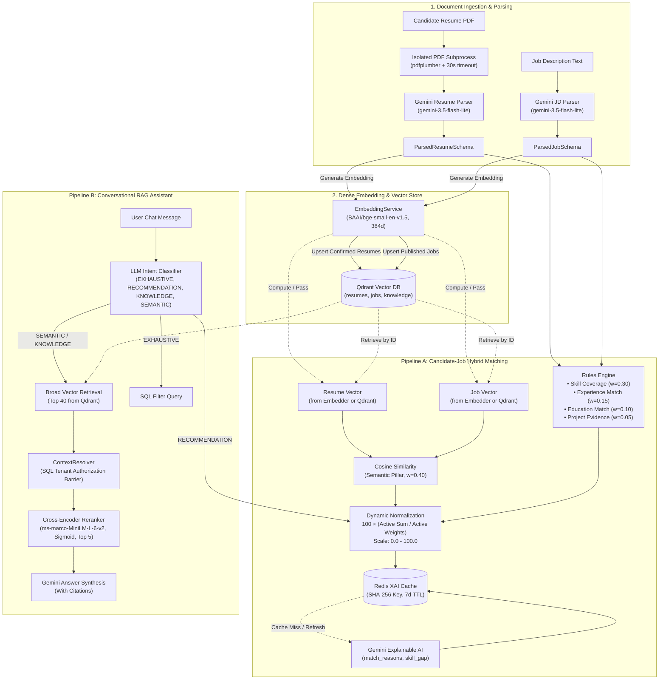
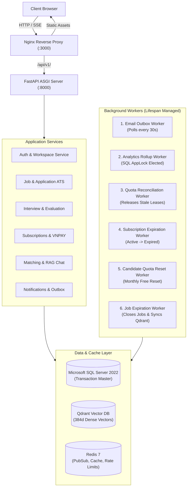

# AI Recruitment Platform

[](https://github.com/DungDao23092005/ai-recruitment-platform/actions/workflows/ci-cd.yml)
[](https://www.python.org/)
[](https://fastapi.tiangolo.com/)
[](https://react.dev/)
[](https://reactrouter.com/)
[](https://tailwindcss.com/)
[](https://www.microsoft.com/sql-server/)
[](https://qdrant.tech/)
[](https://redis.io/)
[](LICENSE)

> A full-stack recruitment platform featuring Applicant Tracking (ATS), Multi-Company Workspaces, Hybrid AI Candidate Matching, Explainable AI (XAI), Conversational RAG Assistance, and Privacy-Preserving Candidate Discovery.

---

## Table of Contents
- [Overview](#overview)
- [Key Features by Role](#key-features-by-role)
- [AI & Machine Learning Architecture](#ai--machine-learning-architecture)
- [System Architecture](#system-architecture)
- [Technology Stack](#technology-stack)
- [Repository Structure](#repository-structure)
- [Database & Data Architecture](#database--data-architecture)
- [API Surface Reference](#api-surface-reference)
- [Security & Privacy Controls](#security--privacy-controls)
- [Local Development Setup](#local-development-setup)
- [Testing & Quality Gates](#testing--quality-gates)
- [Background Workers](#background-workers)
- [License](#license)

---

## Overview

Traditional recruitment platforms often rely on rigid keyword-based filtering, leading to mismatched expectations and prolonged hiring cycles. 

The **AI Recruitment Platform** addresses these challenges with a layered AI architecture combined with structured hiring workflows:
- **Hybrid Candidate Matching:** Evaluates compatibility across semantic text representations (40%), structured skill coverage (30%), experience depth (15%), education criteria (10%), and verified project evidence (5%), dynamically normalized by active job criteria.
- **Explainable AI (XAI):** Generates transparent, evidence-grounded justifications and skill-gap summaries, backed by a content-addressed Redis cache and distributed SQL idempotency leases.
- **Two-Stage RAG Chatbot:** Routes candidate and recruiter queries through an intent classifier supporting exact parameter filtering, personalized job recommendations, platform policy Q&A, and semantic vector search.
- **Privacy-Preserving Candidate Discovery:** Enables recruiters to browse anonymous candidate profiles with automatic PII masking (email, phone, contact details) until candidates accept a formal connection request.
- **Multi-Company Workspaces:** Enables organizations to manage multiple company workspaces seamlessly with role-based member governance (`admin`, `recruiter`, `interviewer`) and strict candidate isolation.

---

## Key Features by Role

### 1. Candidates
- **CV Upload & Parsing:** Upload PDF resumes extracted safely via an isolated subprocess worker. Structured profiles (Skills, Experience, Education, Projects) are generated using Google Gemini.
- **Draft Confirmation Workflow:** Review, edit, and confirm parsed resume data before activating the profile for matching and discovery.
- **Job Discovery & Search:** Search active jobs using traditional keyword filters or natural language semantic search powered by dense vector embeddings.
- **Application Tracking:** Track application status through hiring stages (`APPLIED`, `SCREENING`, `INTERVIEWING`, `OFFERED`, `HIRED`, `REJECTED`, `WITHDRAWN`).
- **Offer & Interview Management:** Respond directly to job offers (accept/decline) and manage interview schedules.
- **Privacy & Contact Requests:** Review, accept, or decline direct recruiter contact requests, maintaining control over personal contact disclosures.
- **AI Career Assistant:** Conversational assistant providing job recommendations, resume guidance, and platform answers.
- **Monthly AI Quotas:** Free monthly allocation of AI actions with automatic calendar-based reset periods.

### 2. Recruiters & Companies
- **Multi-Company Workspace Management:** Switch between authorized company workspaces with 1-click navigation via `X-Company-ID` context scoping.
- **Job Management:** Create and edit job postings with automated JD structuring, required/preferred skill tagging, and automated expiration tracking.
- **Applicant Board & Scoring:** Review applicants ranked by the 5-pillar Hybrid Matching Score (0.0 - 100.0).
- **Explainable AI (XAI):** View detailed explanations highlighting candidate fit and skill gaps with direct evidence citations.
- **Global Candidate Discovery:** Search the anonymous candidate pool. Issue contact requests to unmask candidate contact details upon approval.
- **Collaborative Interviewing:** Schedule interviews, assign team interviewers, and collect structured rubric evaluations.
- **Interview Question Generator:** Generate tailored, role-specific technical and behavioral interview questions.
- **Recruitment Analytics:** Monitor job views, unique visitors, application conversion rates, and 30-day performance trends.
- **Billing & Subscriptions:** Manage company subscription tiers (`FREE`, `PRO`, `ENTERPRISE`), track metered AI usage, and checkout via VNPAY sandbox.

### 3. Interviewers
- **Assigned Interviews:** Dedicated dashboard showing assigned candidate interviews.
- **Structured Scorecards:** Submit quantitative rubric scores and qualitative recommendations to assist hiring decisions.

### 4. Platform Administrators
- **Platform Overview:** Dashboard metrics covering active users, registered companies, active jobs, and system health status.
- **User & Company Moderation:** Activate, deactivate, or delete user accounts; enforce instant logout via real-time SSE signals; inspect registered companies.
- **Job Moderation:** Inspect, edit, and moderate published jobs across all workspaces.
- **Plan & Subscription Administration:** Configure subscription plans, manually provision tiers, and manage customer subscriptions.
- **Payment Orders Audit:** Audit incoming VNPAY payment transactions and order statuses.
- **Email Outbox Queue:** Monitor transactional email delivery queues, inspect failure reasons, and trigger manual retries.
- **Administrative Audit Records:** View logs recording administrative moderation actions and plan modifications.

---

## AI & Machine Learning Architecture

The AI subsystem consists of two distinct functional pipelines:



### 1. Hybrid Matching Formula & Dynamic Normalization
Candidate-Job compatibility evaluates five weighted pillars, dynamically normalized by active requirements:

$$\text{Final Score} = 100 \times \frac{\sum_{i \in \text{Active}} w_i \cdot S_i}{\sum_{i \in \text{Active}} w_i}$$

- **Configured Base Weights ($w_i$):**
  - Semantic Similarity: $w_{\text{semantic}} = 0.40$
  - Skill Coverage: $w_{\text{skills}} = 0.30$
  - Experience Alignment: $w_{\text{exp}} = 0.15$
  - Educational Level: $w_{\text{edu}} = 0.10$
  - Project Evidence: $w_{\text{proj}} = 0.05$
- **Component Scores ($S_i \in [0.0, 1.0]$):**
  - $S_{\text{semantic}}$: Cosine similarity between resume and job dense vectors.
  - $S_{\text{skills}}$: Weighted coverage prioritizing required skills (80%) with preferred skill bonus (20%).
  - $S_{\text{exp}}$: Relevance ratio of candidate years of experience against job minimum.
  - $S_{\text{edu}}$: Ordinal degree level fulfillment score.
  - $S_{\text{proj}}$: Ratio of required skills supported by real-world project descriptions.
- **Dynamic Activation Rules ($\text{Active}$ Set):**
  - Semantic score is **always active** ($w_{\text{semantic}} = 0.40$).
  - Skill coverage and project evidence activate **together** when `required_skills` is non-empty ($+0.35$).
  - Experience match activates when `minimum_years_experience > 0` ($+0.15$).
  - Education match activates when `education_level` is explicitly specified ($+0.10$).
- When all requirements are present, $\sum w_i = 1.00$. If a job omits optional criteria (e.g., no minimum experience or education requirement), those weights are excluded from both numerator and denominator, re-normalizing the remaining active pillars so the final score always reflects the full `0.0 - 100.0` range without penalizing candidates for unrequested criteria.

### 2. Conversational RAG Router (4 Intents)
The conversational agent classifies user intent into 4 execution paths:
1. `EXHAUSTIVE`: Translates natural language into structured SQL queries for exact parameter searches (location, salary, title).
2. `RECOMMENDATION`: Queries the candidate's parsed resume and invokes the Hybrid Matching Engine to return relevant active jobs.
3. `KNOWLEDGE`: Queries platform guidelines and recruitment policies from the Qdrant `knowledge` collection.
4. `SEMANTIC`: Executes vector similarity search across published listings, reranked by the Cross-Encoder.

### 3. AI Quality Benchmarks & Datasets
- **Explainability Benchmark Gate (CI Enforced):** Evaluated via `tests/evaluation/test_explainability_benchmark_gate.py` against `explainability_golden_dataset.json` (20 scenarios). Enforces Precision $\ge 0.95$, Recall $\ge 0.95$, Micro/Macro F1 $\ge 0.90$, and zero post-fallback contradictions.
- **RAG Evaluation Suite (On-Demand):** Evaluated via `backend/scripts/evaluate_rag.py` against `rag_golden_dataset.json` to measure intent routing and retrieval accuracy.

---

## System Architecture



---

## Technology Stack

| Layer | Technology | Version | Purpose |
| :--- | :--- | :--- | :--- |
| **Frontend UI** | React | 18.3.1 | Single-Page Application (SPA) UI framework |
| **Client Routing** | React Router DOM | 7.18.3 | Declarative client-side routing & role guards |
| **Build Tool** | Vite | 5.4.11 | Frontend build tooling & dev server |
| **Styling** | Tailwind CSS | 3.4.17 | Utility-first styling with `tailwind-merge` & `cva` |
| **State Management**| Zustand | 5.0.15 | Global stores (unread notifications, realtime events) |
| **Icons** | Lucide React | 0.474.0 | UI icon set |
| **Backend Framework**| FastAPI | 0.115.0+ | Asynchronous Python web framework |
| **ASGI Server** | Uvicorn | 0.30.0+ | ASGI web server |
| **Runtime** | Python | 3.11.5 | Backend runtime (Docker base: `python:3.11-slim`) |
| **Relational Database**| Microsoft SQL Server| 2022 | Relational database with full Unicode (`NVARCHAR`) |
| **Database ORM** | SQLAlchemy | 2.0.30+ | Asynchronous ORM via `aioodbc` |
| **Migrations** | Alembic | 1.13.0+ | Database schema migration management (38 versions) |
| **Vector Database** | Qdrant | Latest (1.8+ client)| Vector database for semantic search |
| **In-Memory Cache** | Redis | 7.0 (Alpine) | Rate limiting, PubSub, JWT revocation, XAI caching |
| **LLM Provider** | Google Gemini | `gemini-3.5-flash-lite` | Structured parsing, XAI explanations, RAG synthesis |
| **Embeddings** | SentenceTransformers| `BAAI/bge-small-en-v1.5` | 384-dimensional dense text embeddings |
| **Reranker** | Cross-Encoder | `ms-marco-MiniLM-L-6-v2` | Relevance reranking for conversational RAG |
| **Document Parser** | pdfplumber | 0.11.0+ | Isolated PDF text and table extraction |
| **Payments** | VNPAY Gateway | Sandbox API v2 | Checksum-verified payment orders & IPN webhooks |
| **Email Delivery** | Mailpit / SMTP / Resend| Latest | Transactional emails via durable database outbox |

---

## Repository Structure

```text
ai-recruitment-platform/
├── backend/
│   ├── alembic/                      # Database migrations (38 versions)
│   ├── app/                          # Core application package
│   ├── scripts/                      # Management scripts (seeding, maintenance, evaluation)
│   ├── tests/                        # 200+ Pytest test files (unit, integration, evaluation)
│   ├── Dockerfile                    # Standalone backend container build (preloads BGE model)
│   ├── pytest.ini                    # Pytest configuration
│   └── requirements.txt              # Backend Python dependencies
├── frontend/
│   ├── src/                          # React application source
│   ├── package.json                  # Frontend dependencies and npm scripts
│   ├── package-lock.json             # Canonical npm lockfile
│   ├── vite.config.ts                # Vite build configuration
│   └── vitest.config.ts              # Vitest test configuration (114 Vitest test files)
├── docker/
│   ├── Dockerfile.backend            # Compose context backend container build
│   ├── Dockerfile.frontend           # Frontend multi-stage Nginx container build
│   └── nginx.conf                    # Nginx reverse proxy configuration with SSE support
├── docs/                             # Documentation, reports, and architecture diagrams
├── .github/workflows/ci-cd.yml       # GitHub Actions automated CI/CD pipeline
├── docker-compose.yml                # Multi-service local orchestration
└── LICENSE                           # MIT License
```

---

## Database & Data Architecture

The platform manages 33 relational models across 12 business domains:

| Domain | Key Models | Responsibilities |
| :--- | :--- | :--- |
| **Identity & Users** | `User`, `CandidateProfile`, `RecruiterProfile`, `PasswordResetOTP` | Authentication, RBAC, password reset OTPs. |
| **Multi-Tenancy** | `Company`, `CompanyMembership`, `CompanyInvitation` | Workspaces, member roles (`admin`, `recruiter`, `interviewer`), role-guarded invitations. |
| **Jobs & Requirements** | `Job`, `Skill`, `JobSkill` | Job postings, structured criteria, required vs. preferred skill requirements. |
| **Resumes & Candidates**| `Resume` | Structured parsed resumes, confirmation status, draft tracking. |
| **Applications & ATS** | `Application`, `ApplicationNote`, `ApplicationActivity` | Kanban stages, recruiter internal notes, candidate activity timeline. |
| **Interviews** | `Interview`, `InterviewAssignment`, `InterviewEvaluation` | Collaborative scheduling, interviewer assignment, structured evaluation rubrics. |
| **Candidate Privacy** | `CandidateContactRequest`, `ContactDisclosureAuditLog` | Double-opt-in recruiter contact requests, candidate PII unmasking audit logs. |
| **Subscriptions** | `RecruitmentPlan`, `Subscription`, `SubscriptionUsage`, `SubscriptionAuditLog` | Subscription tiers, metered AI quota tracking, reservation reconciliation. |
| **Payments** | `PaymentOrder`, `PaymentTransaction` | VNPAY orders, IPN transaction logging, secure checksum verification. |
| **Analytics** | `JobViewEvent`, `JobViewDailyAggregate` | Raw job view telemetry, daily rolled-up views and unique visitors. |
| **AI Caching** | `AIMatchExplanationIdempotency`, `AIMatchExplanationApplicationLease` | Distributed idempotency locks and leases for explainable AI generation. |
| **System Operations** | `Notification`, `EmailOutbox`, `KnowledgeDocument`, `AdminAuditLog` | Real-time notifications, durable email outbox queue, platform audit trails. |

---

## API Surface Reference

The platform provides **154 API v1 route operations** across 20 functional modules under `/api/v1/` (plus 1 root `GET /` operation):

- **Health (`/api/v1/health` - 3 operations):** Liveness, readiness, and full system health checks.
- **Authentication (`/api/v1/auth` - 8 operations):** Registration, JSON/Form login, JWT revocation, OTP-based password reset.
- **Users & Profiles (`/api/v1/users` - 11 operations):** Candidate/recruiter profiles, resume drafts, confirmation gates.
- **Companies (`/api/v1/companies` - 5 operations):** Recruiter company profile creation, profile updates, and public directory search.
- **Workspaces (`/api/v1/workspaces`, `/api/v1/invitations` - 13 operations):** Workspace listing, member roles, token-based invitations (`preview`, `accept`, `decline`, `revoke`).
- **Jobs (`/api/v1/jobs` - 8 operations):** Public job search, recruiter job CRUD, status management (`DRAFT`, `PUBLISHED`, `CLOSED`, `EXPIRED`).
- **Applications & ATS (`/api/v1/applications` - 30 operations):** Application submission, status transitions, candidate withdrawal, offer acceptance, internal notes, activity timeline.
- **Interviews (`/api/v1/interviews` - 11 operations):** Interview scheduling, interviewer assignment, rubric-based scorecard submission.
- **Contact Requests (`/api/v1/contact-requests` & `/api/v1/candidate/contact-requests` - 8 operations):** Privacy-preserving candidate contact requests, candidate approval/decline, PII unmasking.
- **AI Subsystem (`/api/v1/ai` - 12 operations):** Resume parsing, JD parsing, hybrid matching, explainable AI, interview question generation, semantic search, evaluation runner.
- **Analytics (`/api/v1/analytics` - 1 operation):** Recruiter performance analytics and conversion metrics.
- **Payments (`/api/v1/payments/vnpay` - 4 operations):** VNPAY payment order creation (`POST /create`), customer return callback (`GET /return`), IPN webhook callback (`GET /ipn`), and order status query (`GET /status/{internal_order_id}`).
- **Subscriptions & Plans (`/api/v1/subscriptions`, `/api/v1/plans` - 10 operations):** Subscription tiers, quota status, candidate monthly entitlement.
- **Notifications (`/api/v1/notifications` - 6 operations):** In-app notifications, unread counts, Server-Sent Events (SSE) streaming.
- **Administration (`/api/v1/admin/*` - 24 operations across 5 modules):** Platform-wide user moderation, company moderation, job moderation, plan CRUD, subscription provisioning, email outbox queue, audit logs.

*Interactive API documentation is accessible locally via Swagger UI at `/docs` in development mode.*

---

## Security & Privacy Controls

1. **Candidate Exclusion from Workspaces:** Candidate accounts cannot join company workspaces or receive invitations, maintaining a strict boundary between job seekers and hiring personnel.
2. **PII Masking & Privacy-Preserving Discovery:** In global candidate search, sensitive personal contact details (email, phone, address, portfolio links) are masked with `[redacted]`. Recruiters must issue formal `CandidateContactRequest`s, requiring explicit candidate consent before contact details are unmasked.
3. **Subprocess Isolation for PDF Parsing:** Untrusted PDF uploads are processed in a spawned child subprocess (`pdf_worker.py`) bounded by memory caps and a 30s timeout, protecting the main API process from parser crashes or memory exhaustion.
4. **Rate Limiting:** Redis-backed sliding-window rate limiters protect authentication, AI chat, resume parsing, and matching endpoints from abusive traffic.
5. **Request Envelope Hardening:** General API requests are restricted to 1 MiB; resume uploads are capped at 11 MiB with chunk and deadline timeouts.
6. **Durable Transactional Email Outbox:** Notification emails are committed to the `email_outbox` table atomically within business database transactions and delivered asynchronously by the background outbox worker with exponential backoff retries.

---

## Local Development Setup

### Prerequisites
- [Docker Desktop](https://www.docker.com/) (recommended)
- [Node.js](https://nodejs.org/) v20+ & [npm](https://www.npmjs.com/) (for native frontend development)
- [Python](https://www.python.org/) 3.11+ (for native backend development)
- Microsoft ODBC Driver 18 for SQL Server (for native backend development)

### Running with Docker Compose (Recommended)

1. **Clone the repository:**
   ```bash
   git clone https://github.com/DungDao23092005/ai-recruitment-platform.git
   cd ai-recruitment-platform
   ```

2. **Configure environment variables:**
   ```bash
   cp .env.example .env
   ```
   *Edit `.env` and configure `GEMINI_API_KEY` and `DATABASE_PASSWORD`.*

3. **Start container services:**
   ```bash
   docker compose up --build -d
   ```

4. **Initialize database schema (Alembic Migrations):**
   ```bash
   docker compose exec backend alembic upgrade head
   ```

5. **(Optional) Seed initial development data:**
   ```bash
   # Seed default admin account
   docker compose exec backend python -m scripts.seed_admin

   # Seed default subscription plans
   docker compose exec backend python -m scripts.seed_company_free_plan --config scripts/company_free_plan.json --apply
   docker compose exec backend python -m scripts.seed_candidate_free_plan --config scripts/candidate_free_plan.json --apply

   # Seed knowledge base documents to Qdrant
   docker compose exec backend python scripts/seed_knowledge.py --apply
   ```

6. **Access application endpoints:**
   - **Frontend Application:** [http://localhost:3000](http://localhost:3000)
   - **Backend API & Swagger Docs:** [http://localhost:8000/docs](http://localhost:8000/docs)
   - **Mailpit Webmail UI:** [http://localhost:8025](http://localhost:8025)
   - **Qdrant Vector Dashboard:** [http://localhost:6333/dashboard](http://localhost:6333/dashboard)

---

## Testing & Quality Gates

### Running Backend Tests
Ensure SQL Server, Redis, and Qdrant containers are running:
```bash
cd backend
pip install -r requirements.txt

# Run unit tests
pytest tests/unit

# Run integration tests
pytest tests/integration

# Run explainable AI golden benchmark gate (CI Enforced)
pytest tests/evaluation/test_explainability_benchmark_gate.py

# Optional: Run on-demand RAG evaluation script
python scripts/evaluate_rag.py
```

### Running Frontend Tests
```bash
cd frontend
npm install

# Run type check
npm run typecheck

# Run Vitest test suites
npm run test
```

---

## Background Workers

The application automatically coordinates 6 persistent background workers during lifespan startup:
1. **Email Outbox Worker:** Polls `email_outbox` every 30s to dispatch queued transactional emails with exponential backoff.
2. **Analytics Rollup Worker:** Performs daily rollups of view counts and maintains 90-day telemetry retention using SQL Server application locks.
3. **Quota Reconciliation Worker:** Releases abandoned AI quota reservations older than 60 minutes.
4. **Subscription Expiration Worker:** Transitions expired active subscriptions to `EXPIRED` status.
5. **Candidate Quota Reset Worker:** Resets free candidate monthly AI quotas based on calendar boundaries.
6. **Job Expiration Worker:** Closes jobs whose expiration date has passed and reconciles vector states in Qdrant.

---

## License

This project is licensed under the [MIT License](LICENSE).
